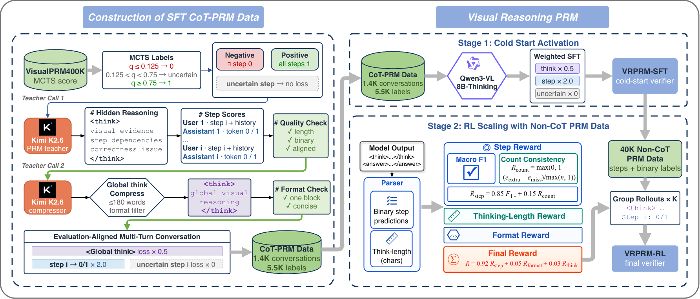
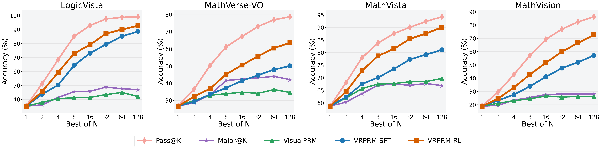

<div align="center">

# VRPRM: Process Reward Modeling via Visual Reasoning

A multimodal **CoT Process Reward Model** trained with a label-efficient two-stage recipe: **quality-controlled CoT-PRM SFT → process-level RL**.

With only **5.5K** step labels + **40K** non-CoT RL samples, VRPRM-RL reaches **69.18 macro F1** on VisualProcessBench (**+7.00** over VisualPRM-8B trained on 400K), and boosts Best-of-8 Overall by **+21.77 / +23.42 / +23.12** across InternVL2.5-8B/26B/38B.

[](https://arxiv.org/abs/2508.03556)
[](https://github.com/two-tiger/VRPRM)
[](https://huggingface.co/two-tiger/VRPRM-sft)
[](https://huggingface.co/two-tiger/VRPRM-rl)
[](https://huggingface.co/datasets/two-tiger/VRPRM-sft-data)
[](LICENSE)

</div>

## 🔍 Overview

<p align="center">
  
</p>

- **Inference protocol** — generate **one reusable global-thinking trace**, then emit **strictly aligned single-token 0/1 judgments** per step; $P(\texttt{1})$ is the step reward.
- **Stage 1 (→ VRPRM-SFT)** — dual-threshold MCTS filtering + two Kimi-K2.6 teacher calls build evaluation-aligned multi-turn CoT-PRM data; weighted SFT with frozen vision encoder + LoRA, only **5.5K labels**.
- **Stage 2 (→ VRPRM-RL)** — GSPO-style group RL on a **40K high-confidence non-CoT pool** with a macro-F1 / count-consistency step reward (+ format & length bonuses).
- **Test-time scaling** — Best-of-N selects the candidate with the highest mean step reward.

## 🏆 Results

**VisualProcessBench (macro F1, no-reference protocol):**

| Model | # Samples | Overall | Δ vs. base |
|:---|---:|---:|:---|
| Qwen3-VL-8B-Thinking (base) | – | 42.48 | — |
| VisualPRM-8B | 400K | 62.18 |  |
| EVPV-PRM | – | 67.46 |  |
| **VRPRM-SFT** | **5.5K** | **66.77** |  |
| **VRPRM-RL** | **5.5K + 40K** | **69.18** |  🔥 |

<sub>VRPRM-RL surpasses VisualPRM-8B by **+7.00** with **72× fewer labeled samples**.</sub>

<p align="center">
  
</p>

<p align="center"><i>Best-of-N scaling for InternVL2.5-8B on four benchmarks. VisualPRM and majority voting saturate quickly, while VRPRM keeps exploiting more candidates; Pass@K is the oracle upper bound. At Bo128, VRPRM-RL leads VRPRM-SFT by up to 15.56 points.</i></p>

## 🚀 Quick Start

```bash
git clone https://github.com/two-tiger/VRPRM.git && cd VRPRM
python -m pip install -r requirements.txt        # data & evaluation
python -m pip install -r sft/requirements-sft.txt # SFT env
python -m pip install -e easyr1                   # RL env
```

**SFT** ([`VRPRM-sft-data`](https://huggingface.co/datasets/two-tiger/VRPRM-sft-data), data construction in [`docs/DATA_GENERATION.md`](docs/DATA_GENERATION.md)):

```bash
THINKING_MODEL_PATH=Qwen/Qwen3-VL-8B-Thinking \
THINKING_MULTITURN_DATASET_PATH=rollout_outputs/visualprm400k_global_think_stepwise_multiturn_sft_neg35.json \
USE_TORCHRUN=true NPROC_PER_NODE=8 bash sft/train_vrprm_sft.sh

bash sft/merge_lora.sh \
  sft/output/qwen3_vl_8b_thinking_global_stepwise_multiturn_sft/checkpoint-513
```

**RL** (start from [`VRPRM-sft`](https://huggingface.co/two-tiger/VRPRM-sft)):

```bash
MODEL_PATH=/path/to/VRPRM-sft DATA_ROOT=data/VisualPRM400K-v1.1-Raw \
N_GPUS_PER_NODE=8 bash easyr1/examples/vrprm/train_vrprm_rl.sh
```

**Evaluation** (model: [`VRPRM-rl`](https://huggingface.co/two-tiger/VRPRM-rl)):

```bash
CUDA_VISIBLE_DEVICES=0,1 TENSOR_PARALLEL_SIZE=2 \
bash benchmarks/visualprocessbench/serve_vllm.sh /path/to/VRPRM-rl

cd benchmarks/visualprocessbench
VPB_MODE=global_think VPB_CONCURRENCY=8 bash run_eval_vpb.sh
```

See [`docs/PROTOCOL.md`](docs/PROTOCOL.md) for full conventions, and [`benchmarks/vlmeval_bon/README.md`](benchmarks/vlmeval_bon/README.md) for Best-of-N evaluation.

## 📖 Citation

```bibtex
@article{chen2026vrprm,
  title   = {VRPRM: Process Reward Modeling via Visual Reasoning},
  author  = {Chen, Xinquan and Yue, Chongying and Liu, Bangwei and
             Wang, Xuhong and Wang, Yingchun and Lu, Chaochao},
  journal = {arXiv preprint arXiv:2508.03556},
  year    = {2026}
}
```

## 📄 License

Code is released under Apache License 2.0. Vendored projects retain their original licenses; model and dataset use is additionally subject to Qwen and VisualPRM400K upstream terms.
